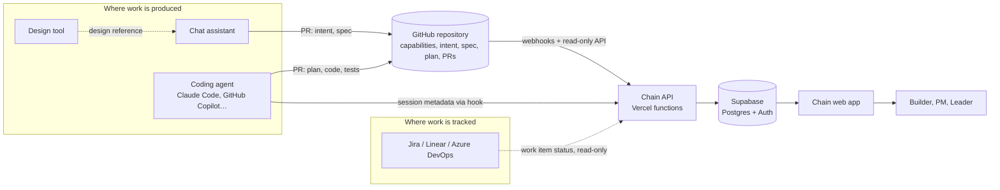
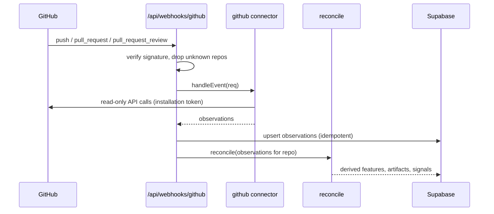

# Architecture

Status: draft for acceptance. Companion to [`intent/chain/spec.md`](../intent/chain/spec.md). Each load-bearing choice below has an [ADR](adr/README.md).

## 1. Shape of the system

Chain is a small read-only pipeline with a visual layer on top:

> **Connectors** observe sources → **observations** are normalised → a pure **reconcile** function derives state and signals → the **web app** renders the derived tables.

The one idea that holds it together: **connectors only observe, and one pure function decides.** Adding a source (Jira, Linear, a new coding agent) means adding a connector, not changing the rules. Rules are testable without a network (ADR-0005).

## 2. Context



Chain has no write path into GitHub, the AI tools or the PM tools. Its only writes are to its own database.

## 3. Components

| Component | Responsibility | Lives in |
|---|---|---|
| **Web app** | Renders boards, detail views, queue, portfolio. Reads derived tables only. | `public/` |
| **API functions** | HTTP entry points: webhook receiver, ingest endpoint, data endpoints, demo scan | `api/` |
| **Connectors** | Turn one source into observations (`github`, `agent-session`, `pm-link`) | `lib/connectors/` |
| **Reconcile core** | Pure function: observations in, feature state and signals out | `lib/reconcile/` |
| **Parsers** | Artifact frontmatter, PR body sections (including the `Light change:` line), review-finding tags | `lib/parse/` |
| **Format readers** (1.1) | Turn another tool's spec layout into the same observations as the native reader (ADR-0012) | `lib/parse/formats/` |
| **Store** | Supabase access, cache, migrations | `lib/store/`, `migrations/` |
| **Session-data template** (1.1) | Settings or a fallback hook script a builder installs to send session aggregates (ADR-0006) | `templates/` |

## 4. The connector seam

```js
/**
 * @typedef {Object} Observation
 * @property {'github'|'agent-session'|'pm-link'} source
 * @property {string} kind        e.g. 'artifact_seen', 'pr_state', 'review_finding', 'commit', 'session_ended', 'link_status'
 * @property {string} repoId
 * @property {string} [featureSlug]
 * @property {string} at          ISO timestamp of the event in the source
 * @property {string} ref         stable reference: commit SHA, PR number, session id, issue key
 * @property {Object} data        kind-specific payload (small; no content bodies)
 */

/**
 * @typedef {Object} Connector
 * @property {string} id
 * @property {(repo, since?) => Promise<Observation[]>} scan      pull-based
 * @property {(req) => Promise<Observation[]>} [handleEvent]       push-based (webhook, ingest)
 */
```

Rules for connectors:

1. Read-only. A connector holds no write credentials.
2. Idempotent. The same event produces the same observation (keyed by `source + kind + ref`).
3. Small payloads. Observations carry facts and references, not file bodies or transcripts.
4. No business rules. A connector never decides health or drift.

Observation kinds in 1.0: `artifact_seen`, `commit`, `pr_state`, `pr_files`, `pr_body`, `review_finding`. Added in 1.1: `session_ended`, `hook_decision`. Added in 1.2: `link_status`.

## 5. Reconcile core

```
reconcile(observations, config) -> { features[], artifacts[], signals[] }
```

- **Pure**: no I/O, no clock reads (time is passed in), no randomness.
- **Deterministic**: the same inputs give the same outputs. This is what makes drift signals defensible.
- **Rule-per-function**: each drift rule in the spec (§7) is one small function with its own tests.
- **Explainable**: every output carries the rule name and evidence references that produced it.

Tests use the fixture repo in `fixtures/` (a complete chain with known drift) and assert exact outputs.

## 6. Data flows

### 6.1 Installed repository (webhook path)



### 6.2 Public repository (demo path)

No installation exists, so no webhook. The demo scan runs on request: it reads through a server-held read-only token, uses ETag conditional requests, and caches results for 5 minutes in Supabase. A response that returns "not modified" does not count against the primary rate limit.

### 6.3 Coding-agent sessions (ingest path, release 1.1)

Metadata reaches `/api/ingest/agent-session` with a per-repo token and an agent profile name (ADR-0013). Sources are chosen per agent by spikes: for Claude Code (S-A), its documented OpenTelemetry export first, then a local fallback hook; for GitHub Copilot (S-H), its session-log links and usage metrics. The endpoint keeps an **allowlist of fields** and drops any prompt, response or tool-content field on receipt. Transcripts are never stored.

## 7. Data model

All tables have `created_at` and `updated_at`. RLS is on for every table. The full definition is in [`migrations/001_initial_schema.sql`](../migrations/001_initial_schema.sql).

| Table | Purpose |
|---|---|
| `repos` | Connected repositories: owner, name, installation id, default branch, paths, `is_public`, owner user |
| `capabilities` | One row per `capabilities/*.md`: slug, statement, owner, target, source path and SHA |
| `features` | One row per `intent/<slug>/`: capability link, lifecycle, health, health reason |
| `artifacts` | One row per feature and type (`intent`, `spec`, `plan`): state, path, SHA, PR number, first commit, accepted time, revision count |
| `pull_requests` | PR facts: state, merged time, last activity, requested changes, checks state, `kind` (`feature`, `light`, `unlinked`), linked feature or capability, changed files and lines |
| `review_findings` | One row per finding: PR, pass, severity, URL. No finding body stored beyond a short excerpt |
| `signals` | Drift and governance signals: kind, severity, evidence URL, detected time, resolution and reason. Attached to a repo, and to a feature or a pull request (light changes have no feature) |
| `sessions` | Coding-agent aggregates: agent profile, times, model if stated, tool counts, plan-mode flag. No content |
| `hook_decisions` | Gate events: hook name, decision, time |
| `links` | Work-item links: system, external id, URL, last known status |
| `observations` | Append-only log of normalised observations: the audit trail of how state was derived |
| `sync_cache` | HTTP response cache with ETag and fetched time |

`observations` is what makes every derived status explainable: state can be recomputed from it at any time.

## 8. Security and privacy

| Concern | Decision |
|---|---|
| **GitHub access** | A GitHub App with read-only permissions: Contents, Pull requests, Metadata. Installation tokens are minted server-side and are short-lived. No user-held tokens are stored. |
| **Sign-in** | Supabase Auth with the GitHub provider. Sign-in identifies the user. Repository access comes from the app installation. |
| **Webhooks** | Signature verified on the raw body. Events for repositories that are not connected are dropped. |
| **Ingest** | Per-repo bearer token, stored hashed, revocable, rate-limited. Payload schema validated server-side; unknown fields are rejected. |
| **Data minimisation** | No file bodies in observations. No prompts, no transcripts. Review findings keep pass, severity, URL and a short excerpt. |
| **Row-level security** | Users see rows for repos they own. Rows for `is_public` repos are readable without sign-in, for demo mode only. |
| **Secrets** | Environment variables only. The `secret-guard` hook blocks writes that look like keys. |
| **Output safety** | All text from repositories is rendered as escaped text or sanitised markdown. Never as raw HTML. |

## 9. Tech stack

| Layer | Choice | Note |
|---|---|---|
| Front end | Vanilla HTML, CSS variables, ES modules, hash routing | No build step (ADR-0009) |
| API | Vercel serverless functions (Node, CommonJS) | One responsibility per function |
| Database and auth | Supabase (Postgres, Auth, RLS), dedicated project | Standalone |
| Source access | GitHub App, REST with conditional requests, webhook-driven (ADR-0014) | Read-only |
| Tests | Node's built-in test runner against fixtures | Pure core needs no network |
| CI | GitHub Actions: tests, lint, Chain's own readiness check | |

## 10. Repository structure

Legend: ✅ exists in this package · ◻ planned (created by its slice).

```
chain/
├── README.md                          ✅ public front door
├── CLAUDE.md                          ✅ project intelligence for Claude Code
├── REVIEW.md                          ✅ review policy and finding tag format
├── chain.yml                          ✅ Chain's own configuration (dogfood)
├── capabilities/                      ✅ five capability files
├── intent/
│   ├── README.md                      ✅ convention
│   └── chain/{intent,spec}.md         ✅ product intent and umbrella spec
│       └── plan.md                    ◻ produced in the coding agent's plan mode
├── docs/
│   ├── architecture.md                ✅ this file
│   ├── agile-mapping.md               ✅
│   ├── landscape.md                   ✅ sourced facts about other tools
│   ├── implementation-guide.md        ✅ how to build Chain, slice by slice
│   └── adr/                           ✅ ADR-0001 to ADR-0012, index, template
├── design/                            ✅ pointer and revision list; export goes here
├── migrations/001_initial_schema.sql  ✅
├── templates/                         ✅ PR template copy, chain.yml example, hook (1.1)
├── .claude/
│   ├── settings.json                  ✅ hooks
│   ├── hooks/                         ✅ secret-guard, production-gate, routing-guard
│   └── skills/                        ✅ intent, spec, adr, architecture-guard
├── .github/
│   ├── pull_request_template.md       ✅
│   └── workflows/ci.yml               ◻ S0
├── public/                            ◻ S0   index.html, css/, js/ (router, views/)
├── api/                               ◻ S0   webhooks/, ingest/, demo.js, data endpoints
├── lib/
│   ├── connectors/                    ◻ S0   github.js, (1.1) agent-session.js, (1.2) pm-link.js
│   ├── reconcile/                     ◻ S1   state.js, signals/*.js (one file per rule)
│   ├── parse/                         ◻ S0   artifact.js, pr-body.js, findings.js
│   │   └── formats/                   ◻ 1.1  speckit.js, kiro.js, openspec.js (ADR-0012)
│   └── store/                         ◻ S1
├── fixtures/                          ◻ S0   a complete chain with known drift
└── test/                              ◻ S0
```

`public/` replaces the root `index.html` of the first scaffold, so that static files and functions are cleanly separated.

## 11. Environments and secrets

| Variable | Needed from slice | Purpose |
|---|---|---|
| `GITHUB_DEMO_TOKEN` | S0 | Server-held, read-only, public data only, for demo mode |
| `SUPABASE_URL`, `SUPABASE_ANON_KEY` | S1 | Client access (anon key is safe in the front end, RLS protects data) |
| `SUPABASE_SERVICE_ROLE_KEY` | S1 | Server-side writes, `api/` only. Never in code |
| `GITHUB_APP_ID`, `GITHUB_APP_PRIVATE_KEY`, `GITHUB_WEBHOOK_SECRET` | S1 | App installation tokens and webhook verification, first for the owner's own repo; multi-user install and sign-in arrive in S3 |
| `CHAIN_INGEST_TOKEN_SALT` | 1.1 | Hashing per-repo ingest tokens |

Environments: local, preview (per pull request), production. Preview deployments use a separate Supabase project and a separate GitHub App.

## 12. Testing

| Level | What | Network |
|---|---|---|
| Unit | Each drift rule and each parser, against fixtures | None |
| Reconcile | Whole-repo fixtures with exact expected output | None |
| Contract | Each connector against recorded GitHub responses | Replayed |
| End to end | One walk-through per slice against Chain's own repo | Real |

The fixture repo includes at least one case for each signal in the spec, plus a repo that does not follow the convention at all.

## 13. Observability

Structured logs with request id, repo id and duration. No repository content and no user data in logs. Every scan records its duration, API calls used and rate-limit remaining.

## 14. Spikes before commitment

| Spike | Question | Blocks |
|---|---|---|
| S-A | Does Claude Code's OpenTelemetry export give what Chain needs (feature attribution, plan-mode identification, session times, repository identity) with content flags off? If not, what does a hook receive? | Release 1.1 (ADR-0006) |
| S-B | Can the GitHub App's user authorisation back Supabase sign-in, or is a separate OAuth app needed? **Desk result: likely yes, one App (ADR-0004); hands-on check first in S3** | Slice S3 (ADR-0004) |
| S-C | REST or GraphQL for batching pull requests, reviews and files? **Result: REST with ETags, driven by webhooks (ADR-0014)** | Slice S1 |
| S-D | How do real review findings look, and does the `[pass]` tag survive? | Slice S2 |
| S-E | Which Jira, Linear and Azure DevOps read scopes are enough? | Release 1.2 |
| S-F | What do Spec Kit, Kiro and OpenSpec really write to disk for one small feature, and how does it map to intent, spec and plan? | Release 1.1 (ADR-0012) |
| S-G | Which trackers do target users run, and is a Chain connector needed beyond Copilot's Jira and Linear integrations? Is Azure DevOps covered by any agent integration? | Release 1.2 (F-41, F-42) |
