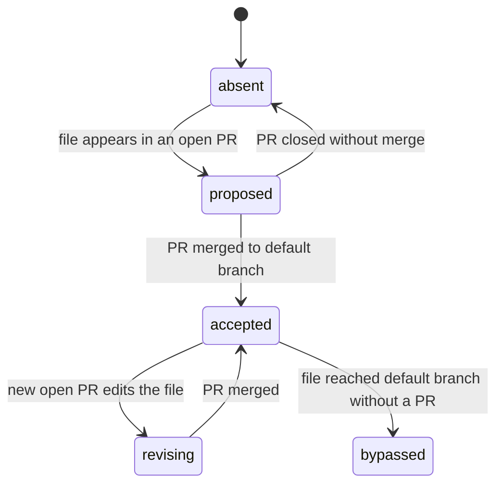

# Spec: Chain

Derived from [`intent.md`](intent.md). This is the **umbrella spec** for the product. Each release slice gets its own `intent/<slug>/` folder when work on it starts (see [Build order](#4-release-plan-and-build-order)).

Architecture, data model and file structure: [`docs/architecture.md`](../../docs/architecture.md).
Decisions: [`docs/adr/`](../../docs/adr/README.md).
How Agile and PM practice maps onto Chain: [`docs/agile-mapping.md`](../../docs/agile-mapping.md).

---

## 1. Scope

Chain reads a team's GitHub repositories and renders three things:

1. **Capabilities**: user goals, written as files, with the features that serve them.
2. **The artifact chain per feature**: `intent.md` → `spec.md` → `plan.md` → build → pull request, with the state of each step.
3. **Signals**: where a human decision is waiting, and where execution drifted from the plan.

It reads two further sources: **Claude Code session metadata** (what the agent did) and **PM-tool work items** (linked by ID). It never writes to any of them in v1.

## 2. Personas and jobs to be done

| Persona | Job to be done | First screen |
|---|---|---|
| **Builder** | "When I start a session, I want to know what is in flight and what to hand to Claude Code next." | Capability board |
| **PM / PO** | "I want to know which intents and specs are waiting for my decision, and whether what shipped matches what we agreed." | Waiting queue |
| **Leader** | "I want one page I can put on a screen in a review, across all our products." | Portfolio |
| **Platform lead** | "I want to know the harness is in place: review policy, hooks, skills." | Readiness check |

## 3. Features

Release: **1.0** Read the chain · **1.1** See the build · **1.2** Link the work · **2** Teams · **3** Organisations.
Capability slugs: `FV` flow-visibility, `DP` drift-prevention, `PV` portfolio-vision, `LW` linked-work, `BT` build-transparency, `—` cross-cutting.

### 3.1 Connect and read

| ID | Feature | Cap. | Rel. | Acceptance criterion |
|---|---|---|---|---|
| F-01 | Sign in with GitHub | — | 1.0 | A user signs in with GitHub and sees only repositories they connected |
| F-02 | Install the Chain GitHub App on chosen repos | — | 1.0 | The app requests read-only permissions only; a repo can be removed at any time |
| F-03 | Repository scan | FV | 1.0 | Chain finds `capabilities/*.md` and `intent/<slug>/{intent,spec,plan}.md` on the default branch and on open PR branches |
| F-04 | Demo mode for public repositories | — | 1.0 | Anyone can paste a public repo URL and see its board without signing in; responses are cached |
| F-05 | Webhook sync with cached fallback | — | 1.0 | Push, pull request and review events update state within a minute; without a webhook, a page load refreshes data older than 5 minutes |

### 3.2 See the flow (capability `FV`)

| ID | Feature | Cap. | Rel. | Acceptance criterion |
|---|---|---|---|---|
| F-10 | Capability board | FV | 1.0 | One card per capability: statement, progress (shipped / total), health pill, last activity, most recent feature's chain bar |
| F-11 | Capability detail | FV | 1.0 | Statement, why, owner, target, and a row per feature with chain bar and lifecycle |
| F-12 | Feature detail | FV | 1.0 | Chain nodes show state, file path (mono), source surface and last commit; clicking a node opens its preview |
| F-13 | Artifact preview | FV | 1.0 | Rendered markdown of the artifact at its accepted SHA, with a link to GitHub |
| F-14 | Waiting-on-a-human queue | FV | 1.0 | Lists every artifact in `proposed` state with its PR, age, requested reviewers; sorted by age |
| F-15 | Source-surface labelling | FV | 1.0 | Each artifact shows where it was produced (Claude Design, Claude.ai, Claude Code, human, unknown) using the detection ladder in §5.4, with a confidence label |
| F-16 | Design node | FV | 1.0 | If a feature folder declares a design reference, the chain shows a Claude Design node; otherwise it shows as skipped (dashed), not missing |
| F-70 | "Start session" prompt | FV | 1.0 | Copies a ready-to-paste Claude Code prompt naming the feature's accepted artifacts and paths (Chain does not write to the repo) |

### 3.3 Prevent drift (capability `DP`)

| ID | Feature | Cap. | Rel. | Acceptance criterion |
|---|---|---|---|---|
| F-20 | Health model | DP | 1.0 | Every feature has a health (`on track`, `drift`, `blocked`) with a stated reason; rules in §6 |
| F-21 | Rework signals from Git | DP | 1.0 | Detects intent edited after spec, spec edited after plan, plan revised during build, from commit history only |
| F-22 | Review and PR signals | DP | 1.0 | Detects `[compliance]` findings (Important or Block) and a non-empty "Divergences from plan" section in the PR body |
| F-23 | Drift detail | DP | 1.0 | Each signal shows kind, rule, evidence link (commit, PR or comment) and when it was detected |
| F-24 | Lead-time and rework metrics | DP | 1.1 | Intent→spec time, plan accepted→merged time, intent acceptance rate, rework counts per feature, from Git only |
| F-25 | Readiness check | DP | 1.1 | Scores a repo against the harness checklist (§7): `CLAUDE.md`, `REVIEW.md`, skills, hooks, PR template, folder convention |
| F-26 | Signal feedback | DP | 1.1 | A signal can be dismissed with a reason or marked valid; dismissals are stored and shown, never silently dropped |

### 3.4 Portfolio (capability `PV`)

| ID | Feature | Cap. | Rel. | Acceptance criterion |
|---|---|---|---|---|
| F-30 | Portfolio table | PV | 1.0 | One row per connected repo/product with capability counts, health mix, waiting count |
| F-31 | Cross-product rollups | PV | 1.1 | Aggregate drift and waiting queue across products |
| F-32 | Share view | PV | 1.1 | A read-only link to a board or portfolio; light theme, print-friendly; revocable |
| F-33 | Quarter view | PV | 2 | Capabilities grouped by target quarter |

### 3.5 Linked work (capability `LW`)

| ID | Feature | Cap. | Rel. | Acceptance criterion |
|---|---|---|---|---|
| F-40 | Link display | LW | 1.0 | `links:` in artifact frontmatter are shown as chips with URLs; no API call |
| F-41 | Jira connector | LW | 1.2 | Reads status and assignee of linked issues, read-only |
| F-42 | Linear connector | LW | 1.2 | Same, for Linear issues |
| F-43 | Azure DevOps connector | LW | 1.2 | Same, for work items |
| F-44 | Link health | LW | 1.2 | Flags an artifact whose linked item is missing or closed while the artifact is still open |

### 3.6 Build transparency (capability `BT`)

| ID | Feature | Cap. | Rel. | Acceptance criterion |
|---|---|---|---|---|
| F-50 | Claude Code ingest | BT | 1.1 | An ingest endpoint with a per-repo token accepts session metadata from a hook script; a template hook ships in `templates/` |
| F-51 | Session timeline | BT | 1.1 | Per feature: number of sessions, duration, models, tool-use counts, whether plan mode was used |
| F-52 | Hook decision log | BT | 1.1 | Shows blocked and approved gate events (for example a production gate) per feature |
| F-53 | Cost per feature | BT | 1.2 | Token or cost totals per feature, if the spike confirms the data is available |

### 3.7 Cross-cutting

| ID | Feature | Cap. | Rel. | Acceptance criterion |
|---|---|---|---|---|
| F-60 | Light and dark themes | — | 1.0 | Both themes meet WCAG 2.1 AA contrast; status is never colour-only |
| F-61 | Settings and `chain.yml` | — | 1.0 | Paths, stale threshold, pass names and link patterns come from `chain.yml` in the repo, with defaults when absent |
| F-62 | Audit export | — | 1.1 | JSON export of a feature's full chain, signals and sessions |
| F-63 | Notifications | — | 2 | Email or Slack when a drift signal appears or an artifact waits too long |
| F-64 | Roles and teams | — | 2 | Invite members; viewer and owner roles |

## 4. Release plan and build order

| Release | Name | Contains |
|---|---|---|
| **1.0** | Read the chain | F-01–F-05, F-10–F-16, F-20–F-23, F-30, F-40, F-60, F-61, F-70 |
| **1.1** | See the build | F-24–F-26, F-31, F-32, F-50–F-52, F-62 |
| **1.2** | Link the work | F-41–F-44, F-53 |
| **2** | Teams | F-33, F-63, F-64 |
| **3** | Organisations | Multi-org, SSO, managed policies (not specified yet) |

Release 1.0 is built in slices. Each slice is demonstrable on its own, and each starts with its own `intent/<slug>/intent.md` before any code.

| Slice | Goal | Features | Demo moment |
|---|---|---|---|
| **S0** Walking skeleton | A public repo renders as a board, no login | F-04, F-03, F-10, F-12 (static) | Paste Chain's own repo URL, see Chain's own chain |
| **S1** State | Artifact state and the human-wait queue are right | F-05, F-14, F-20 (without drift) | Open a PR on an intent, watch it appear as "proposed" |
| **S2** Drift | Deterministic signals with evidence | F-21, F-22, F-23 | Edit a spec after plan acceptance, see the signal |
| **S3** Connect | Sign-in, app install, multi-repo | F-01, F-02, F-30, F-61 | Connect a private repo |
| **S4** Finish | Previews, labels, links, themes, start prompt | F-13, F-15, F-16, F-40, F-60, F-70 | Full walk-through |

## 5. Conventions Chain reads

### 5.1 Repository layout

```
capabilities/<slug>.md          one file per capability
intent/<slug>/intent.md         one folder per feature (or product)
intent/<slug>/spec.md
intent/<slug>/plan.md
chain.yml                       optional configuration (see 5.3)
```

This follows the folder-per-feature convention used in Thiga's AI-native SDLC dojo (MIT). It is a convention Chain reads, not one it invents. A repo that does not follow it still renders, with its features shown as unassigned.

### 5.2 Frontmatter (optional)

```yaml
---
capability: flow-visibility        # links the feature to a capability
produced_with: claude-ai           # claude-design | claude-ai | claude-code | human
design: https://...                # reference to a design, shown as the design node
links:                             # work items in other systems
  jira: PROJ-123
  linear: ENG-45
---
```

Frontmatter never carries status. State is derived (ADR-0003).

### 5.3 `chain.yml`

```yaml
paths:
  capabilities: capabilities
  intent: intent
review:
  passes: [bugs, security, compliance]   # tag format: a line starting with [pass]
  drift_passes: [compliance]
health:
  stale_days: 7                          # an open artifact PR with no activity is blocked
```

### 5.4 Source-surface detection ladder

Best effort, first match wins, shown with a confidence label:

1. `produced_with` in frontmatter (explicit).
2. Commit trailers that identify Claude (for example `Co-Authored-By` naming Claude, or a Claude session link).
3. Branch prefix `claude/`.
4. Otherwise `unknown`. Chain never guesses beyond this.

Claude Design leaves no Git trace, so its node relies on the `design:` reference (F-16).

### 5.5 Linking a pull request to a feature

First match wins:

1. The PR changes files under `intent/<slug>/`.
2. The PR body contains `Feature: <slug>`.
3. The PR has the label `feature:<slug>`.

### 5.6 Pull request template

Chain ships a template ([`.github/pull_request_template.md`](../../.github/pull_request_template.md)) with a **Feature**, a **Plan match** and a **Divergences from plan** section. A non-empty divergences section is a drift signal (F-22).

## 6. State model

Two separate axes. Lifecycle says where a feature is. Health says whether it is going well.

**Artifact state** (per `intent`, `spec`, `plan`):



`bypassed` is accepted content that skipped the human gate. It is shown, and it raises a `gate_bypassed` signal.

**Lifecycle** (per feature, derived):

| Lifecycle | Rule |
|---|---|
| `idea` | Intent is `proposed` |
| `specified` | Intent `accepted`; spec absent or `proposed` |
| `planned` | Spec `accepted`; plan absent or `proposed` |
| `building` | Plan `accepted`; a linked PR is open or has commits, none merged |
| `shipped` | A linked build PR is merged to the default branch after plan acceptance |

**Health** (per feature, evaluated in this order):

1. `drift` if any unresolved signal of severity `warn` or `high` exists (§7).
2. `blocked` if any artifact PR has requested changes, failing required checks, or no activity for `stale_days`.
3. `on track` otherwise.

A shipped feature can still show `drift`. That is the point.

**Capability roll-up:** progress = features `shipped` / features with an accepted intent. Health = the worst health among its features. Features with only a proposed intent are listed separately as "proposed".

## 7. Drift rules (deterministic)

| Signal kind | Rule | Severity | Source |
|---|---|---|---|
| `intent_rework` | `intent.md` modified in a commit after the first commit of `spec.md` | warn | Git history |
| `spec_rework` | `spec.md` modified in a commit after the first commit of `plan.md` | warn | Git history |
| `plan_revised` | `plan.md` modified in a build PR (a declared departure from the plan) | info | PR files |
| `pr_declares_divergence` | PR body "Divergences from plan" section is non-empty and not "None" | warn | PR body |
| `compliance_finding` | A review finding tagged `[compliance]` with severity Important or Block | high | PR review |
| `gate_bypassed` | An artifact reached the default branch without a PR | high | Git history |

`intent_rework` and `spec_rework` correspond to the playbook's rework indicators for the Plan and Design stages. They can be counted from Git history alone.

A signal is resolved only by a person: dismissed with a reason (F-26) or superseded by an accepted revision. Chain never auto-resolves.

**Readiness checklist (F-25):** `CLAUDE.md` with a verification block, `REVIEW.md`, at least one skill in `.claude/skills/`, `.claude/settings.json` with hooks, a PR template, the folder convention, branch protection requiring review (read from the GitHub API where permitted).

## 8. Screens and routes

| Route | Screen | Features |
|---|---|---|
| `/#/` | Capability board | F-10, F-14 (queue badge) |
| `/#/capability/:slug` | Capability detail | F-11 |
| `/#/feature/:repo/:slug` | Feature detail with chain | F-12, F-13, F-15, F-16, F-23, F-40, F-51, F-70 |
| `/#/waiting` | Waiting-on-a-human queue | F-14 |
| `/#/portfolio` | Portfolio | F-30, F-31 |
| `/#/readiness/:repo` | Readiness check | F-25 |
| `/#/settings` | Repos, thresholds, ingest tokens | F-02, F-50, F-61 |
| `/#/demo` | Paste a public repo URL | F-04 |

The first Claude Design export covers the board, capability detail, feature detail, portfolio and settings. Gaps against this spec are listed in [`design/README.md`](../../design/README.md).

## 9. Non-functional requirements

| Area | Requirement |
|---|---|
| **Security** | Read-only GitHub App permissions. Webhook signatures verified. RLS on every table. No secrets in the repo. Installation tokens are short-lived and server-side only. |
| **Privacy** | Prompts and transcripts are never ingested. Session data is aggregates only, computed on the builder's machine. Public-repo data is already public; private-repo data is visible only to the connecting user. |
| **Performance** | Board renders from derived tables in under 1 second. Scans only read `capabilities/`, `intent/` and PRs that touch them. |
| **Rate limits** | Webhooks first, conditional requests (ETag) for refreshes, a Supabase cache with a 5-minute TTL. Demo mode uses a server-held read-only token. |
| **Accessibility** | WCAG 2.1 AA. Status uses text or shape as well as colour. Keyboard operable. Reduced motion respected. |
| **Reliability** | Scans are idempotent. A failed scan keeps the last good state and shows its age. |
| **Transparency** | Every derived status can show the rule and evidence that produced it. |

## 10. Success measures

| Measure | Target | How measured |
|---|---|---|
| Time from connecting a repo to a first board | ≤ 5 minutes | Timed walk-through |
| Chain's own repo shows a complete chain | ≥ 10 features by release 1.0 | The demo itself |
| Drift signals judged valid by the repo owner | ≥ 80% | F-26 feedback |
| Chain decisions with an ADR before code | 100% | Review compliance pass |
| Playbook indicators computable from Git alone | Intent→spec time, plan→merge time, rework counts | F-24 |

## 11. Risks

| Risk | Effect | Mitigation |
|---|---|---|
| PR↔feature linking is inconsistent in real repos | Features show wrong lifecycle | Three linking rules, `Feature:` line in the PR template, unlinked PRs listed separately |
| Review-finding tag format varies | `compliance_finding` misses or false-fires | Tag format defined in `REVIEW.md`, configurable in `chain.yml`, tested on real findings before 1.0 |
| Claude Code hook payloads differ from assumptions | Session connector rework | Spike first; connector ships in 1.1, not 1.0 |
| Vanilla front end gets heavy | Slower delivery | Revisit trigger in ADR-0009: more than 8 views or shared state across views |
| Source-surface detection is weak | Mislabelled flow | Explicit `produced_with` first, confidence shown, `unknown` allowed |
| Three sources in v1 widen scope | Late or thin 1.0 | Sources ship in separate releases; the connector seam (ADR-0005) is built in 1.0 |

## 12. Open questions

1. Name, trademark and domain check for "Chain".
2. Licence for the public repository.
3. Spike: Claude Code hook payloads, and whether OpenTelemetry is a better source for organisations (ADR-0006).
4. Spike: reuse the GitHub App's user authorisation for Supabase sign-in, or use a separate OAuth app (ADR-0004).
5. REST or GraphQL for pull-request batches.
6. Branch protection is only readable with higher permissions. Is the readiness check allowed to ask for them, or does it stay optional?

## 13. Traceability to the playbook

| Playbook stage and play | Where Chain reflects it |
|---|---|
| Plan: capture as `intent.md` | F-03, F-14 (intent proposed and accepted) |
| Design: requirements and design | F-03, F-16 (design node) |
| Build: plan mode, `plan.md` committed, plan synced in the same commit | F-21 (`plan_revised`), F-70 |
| Build: hooks, skills, `CLAUDE.md` | F-25, F-52 |
| Test: feedback loop, verification evidence | PR template "Verification", F-51 |
| Deploy: AI in the PR review loop, `REVIEW.md` | F-22 |
| Deploy: hooks as approval gates | F-52, `gate_bypassed` |
| Maintain: close the loop with a new intent | A new `intent/<slug>/` folder; Chain shows it as a new feature |
| Source of truth per artifact (legacy systems sidebar) | ADR-0007, F-40–F-44 |
